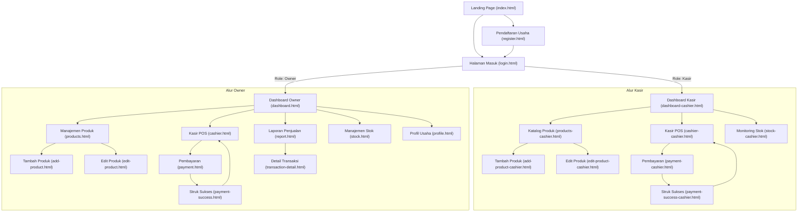

# pos.it — Sistem Kasir & Manajemen Usaha UMKM (Point of Sale)

> **Proyek Akhir Mata Kuliah Interaksi Manusia dan Komputer (IMK)**  
> **Fakultas Ilmu Komputer, Universitas Brawijaya (FILKOM UB)**

---

## 📌 Tentang Projek

**pos.it** adalah aplikasi kasir (*Point of Sale* / POS) dan manajemen usaha berbasis web yang dirancang khusus untuk mempermudah operasional harian para pelaku UMKM (Usaha Mikro, Kecil, dan Menengah). Mulai dari pencatatan katalog produk, transaksi kasir yang cepat, kalkulasi otomatis, penerbitan struk pembayaran digital, pemantauan stok barang *real-time*, hingga analisis performa penjualan harian melalui grafik visual.

Aplikasi ini dikembangkan sebagai **Projek Akhir Mata Kuliah Interaksi Manusia dan Komputer (IMK) di FILKOM Universitas Brawijaya**. Perancangan sistem ini menitikberatkan pada aspek pengalaman pengguna (*User Experience / UX*) dan antarmuka (*User Interface / UI*) yang berpegang pada prinsip-prinsip IMK, antara lain:
- **Kemudahan Penggunaan (*Ease of Use & Learnability*)**: Tata letak yang bersih, intuitif, dan tidak membingungkan pengguna awam.
- **Efisiensi Alur Kerja (*Efficiency of Use*)**: Alur transaksi kasir yang cepat, minim klik, dengan kalkulasi subtotal, pajak, dan kembalian otomatis.
- **Konsistensi & Standar (*Consistency and Standards*)**: Penggunaan ikonografi (*Bootstrap Icons*), tipografi (*Inter*), serta skema warna yang terstandarisasi di seluruh modul.
- **Pencegahan & Penanganan Kesalahan (*Error Prevention & Recovery*)**: Validasi input formulir, konfirmasi stok sebelum checkout, dan peringatan stok menipis secara visual.
- **Pembagian Peran Pengguna (*Role-Based Interface*)**: Pemisahan hak akses antara Pemilik Usaha (*Owner*) dan Staf Kasir untuk menjaga keamanan serta fokus kerja masing-masing peran.

---

## 🚀 Teknologi & Framework yang Digunakan

Aplikasi ini dibangun menggunakan arsitektur *frontend-driven* yang cepat, ringan, dan mandiri tanpa memerlukan ketergantungan instalasi server backend yang kompleks:

| Komponen | Teknologi / Pustaka | Keterangan & Kegunaan |
| :--- | :--- | :--- |
| **Markup & Struktur** | **HTML5** | Struktur semantik standar web modern pada seluruh antarmuka. |
| **CSS Framework** | **Bootstrap 5 (v5.3.8)** | Sistem *grid layout* responsif, utilitas spasi, komponen modal, dan form input. |
| **Styling Kustom** | **CSS3 (Modular Stylesheets)** | Penataan visual khusus per modul (`cashierStyle.css`, `dashboardStyle.css`, `paymentStyle.css`, dll.) dengan tema warna khas *warm brand*. |
| **Ikonografi** | **Bootstrap Icons (v1.11.3)** | Set ikon intuitif untuk memperjelas aksi dan navigasi visual bagi pengguna. |
| **Tipografi** | **Google Fonts (Inter)** | Huruf sans-serif modern dengan tingkat keterbacaan (*readability*) tinggi pada berbagai ukuran layar. |
| **Visualisasi Data** | **Chart.js (v4.4.3)** | Pustaka grafik interaktif berbasis Canvas untuk menampilkan grafik batang (*bar*) dan garis (*line*) tren penjualan per jam. |
| **Logika Bisnis** | **Vanilla JavaScript (ES6+)** | Logika pemrosesan transaksi, filter data, manipulasi DOM dinamis, serta pengelolaan status aplikasi. |
| **Penyimpanan Lokal** | **Web Storage API (`localStorage` & `sessionStorage`)** | Persistensi data di sisi browser klien (database produk, riwayat transaksi, profil bisnis, dan sesi login). |

---

## 🔄 Arsitektur Routing & Alur Navigasi

Aplikasi menggunakan arsitektur **Multi-Page Application (MPA)** berbasis file `.html` yang dihubungkan secara dinamis melalui navigasi *client-side*.

### 1. Pembagian Peran Pengguna (Role-Based Access)

Sistem membedakan navigasi berdasarkan peran pengguna yang login:
1. **Owner (Pemilik Usaha)**: Memiliki akses menyeluruh ke seluruh sistem (Beranda, Manajemen Produk penuh, Kasir, Laporan Penjualan komprehensif, Manajemen Stok, dan Profil Usaha).
2. **Kasir**: Memiliki akses ke antarmuka operasional (Beranda Kasir, Katalog Produk, Kasir, dan Monitoring Stok) tanpa akses laporan finansial mendalam dan pengaturan profil usaha.



---

### 2. Matriks Rute Halaman

Berikut adalah daftar lengkap berkas halaman dan cakupan fungsinya:

| Berkas Halaman | Peran | Deskripsi Halaman & Fitur Utama |
| :--- | :---: | :--- |
| `index.html` | Publik | *Landing page* promosi aplikasi pos.it, perkenalan fitur, dan tombol masuk/daftar. |
| `login.html` | Publik | Formulir masuk pengguna; memvalidasi kredensial dan mengarahkan ke dashboard yang sesuai peran. |
| `register.html` | Publik | Formulir pendaftaran akun dan usaha baru. |
| `dashboard.html` | Owner | Ringkasan omzet harian, jumlah transaksi, produk terjual, grafik penjualan per jam, produk terlaris, dan notifikasi stok menipis. |
| `dashboard-cashier.html` | Kasir | Ringkasan harian khusus operasional kasir dan riwayat transaksi terkini. |
| `products.html` | Owner | Daftar inventaris produk, filter kategori, status produk, tombol tambah, dan tombol edit. |
| `products-cashier.html` | Kasir | Katalog produk untuk kasir mengecek ketersediaan dan harga barang. |
| `add-product.html` | Owner | Formulir tambah produk baru (nama, kategori, harga, stok, satuan, status ketersediaan, dan gambar). |
| `add-product-cashier.html` | Kasir | Formulir tambah produk versi kasir. |
| `edit-product.html` | Owner | Formulir pembaruan data dan harga produk yang telah tersimpan. |
| `edit-product-cashier.html` | Kasir | Formulir ubah data produk versi kasir. |
| `cashier.html` | Owner | Ruang kerja kasir interaktif: pemilihan produk, pencarian cepat, item kustom, kalkulasi subtotal & pajak (PPN), dan checkout. |
| `cashier-cashier.html` | Kasir | Ruang kerja kasir khusus akun staf kasir. |
| `payment.html` | Owner | Halaman penyelesaian pembayaran: pemilihan metode (Tunai / QRIS), input uang diterima, dan kalkulasi kembalian otomatis. |
| `payment-cashier.html` | Kasir | Halaman penyelesaian pembayaran versi staf kasir. |
| `payment-success.html` | Owner | Konfirmasi transaksi berhasil, rincian nota digital, opsi cetak/unduh struk, dan tombol transaksi baru. |
| `payment-success-cashier.html` | Kasir | Konfirmasi transaksi berhasil dan pencetakan struk digital untuk kasir. |
| `report.html` | Owner | Analisis penjualan mendalam: filter rentang tanggal, grafik bar/line penjualan per jam, metrik finansial, riwayat transaksi lengkap, dan ekspor laporan. |
| `stock.html` | Owner | Pemantauan status stok (Aman, Menipis, Habis) dan penyesuaian kuantitas stok barang. |
| `stock-cashier.html` | Kasir | Monitoring ketersediaan stok produk bagi kasir saat bertransaksi. |
| `profile.html` | Owner | Pengaturan informasi bisnis (nama usaha, kategori usaha, alamat, kontak, dan logo) yang otomatis tersinkronisasi ke *sidebar* di seluruh halaman. |
| `transaction-detail.html` | Owner | Halaman inspeksi rincian pesanan dari suatu transaksi tertentu. |

---

## 💾 Pengelolaan Data (Client-Side State)

Sistem memanfaatkan `localStorage` dan `sessionStorage` sebagai basis data lokal tanpa memerlukan instalasi database tambahan:

1. **`posit_products_v2` (`localStorage`)**:
   - Menyimpan seluruh data produk, termasuk `id`, `name`, `category`, `price`, `stok`, `minStok`, `unit`, `status`, dan gambar.
   - Dikelola melalui fungsi modular di `js/productsData.js` (`getProducts()`, `addProduct()`, `updateProduct()`, `deleteProduct()`).

2. **`posit_transactions_v2` (`localStorage`)**:
   - Menyimpan log transaksi yang berhasil dicatat lengkap dengan nomor nota (`SJ-DDMMYY-XXXX`), tanggal, waktu, kasir bertugas, item pesanan, subtotal, pajak, total, metode bayar, dan nominal kembalian.
   - Dikelola melalui fungsi di `js/transaction.js` (`getTransactions()`, `addTransaction()`, `getTransactionById()`).

3. **`posit_business_profile` (`localStorage`)**:
   - Menyimpan informasi identitas usaha (nama, tipe/kategori usaha, alamat, nomor telepon, email, serta logo base64).
   - Dikelola melalui `js/companyProfile.js` yang secara otomatis memperbarui *branding* di *sidebar* seluruh halaman aplikasi.

4. **`pos_user` (`sessionStorage`)**:
   - Menyimpan sesi aktif akun yang sedang masuk (`name`, `role`, `business`).

---

## 📂 Struktur Direktori

```text
website-imk/
├── assets/                          # Berkas aset gambar dan ilustrasi
│   └── cashier.webp                 # Ilustrasi halaman beranda & landing page
├── css/                             # Berkas stylesheet styling antarmuka (CSS3)
│   ├── addProductStyle.css          # Styling formulir tambah & edit produk
│   ├── cashierStyle.css             # Styling antarmuka Point of Sale (POS)
│   ├── dashboardStyle.css           # Styling dasar layout, sidebar, topbar, & kartu ringkasan
│   ├── homeStyle.css                # Styling landing page (index.html)
│   ├── loginStyle.css               # Styling halaman autentikasi masuk
│   ├── paymentStyle.css             # Styling halaman pembayaran & kalkulasi kembalian
│   ├── productsStyle.css            # Styling daftar katalog produk & filter
│   ├── profileStyle.css             # Styling halaman profil bisnis & pengaturan akun
│   ├── registerStyle.css            # Styling formulir registrasi
│   ├── reportStyle.css              # Styling halaman laporan penjualan & grafik analitik
│   ├── stockStyle.css               # Styling halaman pemantauan inventaris stok
│   └── trxDetailStyle.css           # Styling rincian nota & transaksi
├── js/                              # Skrip logika bisnis dan persistensi data (ES6)
│   ├── companyProfile.js            # Manajemen data & update otomatis profil bisnis di sidebar
│   ├── productsData.js              # Manajemen CRUD data produk & kalkulasi inventaris
│   └── transaction.js               # Manajemen riwayat transaksi, penomoran nota, & kalkulasi
├── add-product-cashier.html         # Tambah produk (akses kasir)
├── add-product.html                 # Tambah produk (akses owner)
├── cashier-cashier.html             # Kasir POS (akses kasir)
├── cashier.html                     # Kasir POS (akses owner)
├── dashboard-cashier.html           # Beranda dashboard (akses kasir)
├── dashboard.html                   # Beranda dashboard utama (akses owner)
├── edit-product-cashier.html        # Edit produk (akses kasir)
├── edit-product.html                # Edit produk (akses owner)
├── index.html                       # Landing page utama
├── login.html                       # Halaman masuk
├── payment-cashier.html             # Halaman pembayaran (kasir)
├── payment-success-cashier.html     # Struk sukses pembayaran (kasir)
├── payment-success.html             # Struk sukses pembayaran (owner)
├── payment.html                     # Halaman pembayaran (owner)
├── products-cashier.html            # Katalog produk (kasir)
├── products.html                    # Manajemen produk (owner)
├── profile.html                     # Profil usaha & toko (owner)
├── register.html                    # Halaman daftar akun usaha
├── report.html                      # Laporan komprehensif & grafik analitik (owner)
├── stock-cashier.html               # Cek stok barang (kasir)
├── stock.html                       # Manajemen & penyesuaian stok (owner)
├── transaction-detail.html          # Detail nota transaksi (owner)
└── README.md                        # Dokumentasi resmi projek
```

---

## 💻 Panduan Menjalankan Projek

Aplikasi ini tidak memerlukan instalasi runtime backend (Node.js/PHP/Python) atau kompilasi build khusus. Anda dapat langsung menjalankannya dengan salah satu langkah berikut:

### Opsi 1: Menggunakan Ekstensi VS Code *Live Server* (Disarankan)
1. Buka folder `website-imk` menggunakan text editor **Visual Studio Code**.
2. Pasang ekstensi **Live Server** (oleh Ritwick Dey) dari menu Extensions.
3. Klik kanan pada berkas `index.html`, lalu pilih **"Open with Live Server"**.
4. Aplikasi akan otomatis terbuka di peramban web pada alamat `http://127.0.0.1:5500/index.html`.

### Opsi 2: Menggunakan HTTP Server Sederhana
Buka terminal di dalam direktori `website-imk`, lalu jalankan:
```bash
# Menggunakan Python 3:
python -m http.server 8000

# Atau menggunakan npx serve:
npx serve .
```
Buka browser dan akses alamat `http://localhost:8000`.

### Opsi 3: Membuka Berkas Langsung di Browser
Buka berkas `index.html` langsung melalui browser pilihan Anda (Google Chrome, Microsoft Edge, Mozilla Firefox, dsb.).

---

## 🔑 Kredensial Akun Pengujian (Demo Login)

Untuk mencoba alur autentikasi dan membedakan tampilan antarmuka antara kedua peran, gunakan akun demo berikut pada halaman `login.html`:

| Peran (*Role*) | Email / No. HP | Kata Sandi | Dashboard Tujuan |
| :--- | :--- | :--- | :--- |
| **Owner (Pemilik Usaha)** | `damar@imkafe.id` | `kafe1234` | `dashboard.html` |
| **Kasir** | `081234567890` | `kasir123` | `dashboard-cashier.html` |

---

## 👥 Pengembang & Akademik

- **Mata Kuliah**: Interaksi Manusia dan Komputer (IMK)
- **Fakultas / Program Studi**: Fakultas Ilmu Komputer (FILKOM)
- **Universitas**: Universitas Brawijaya (UB)
